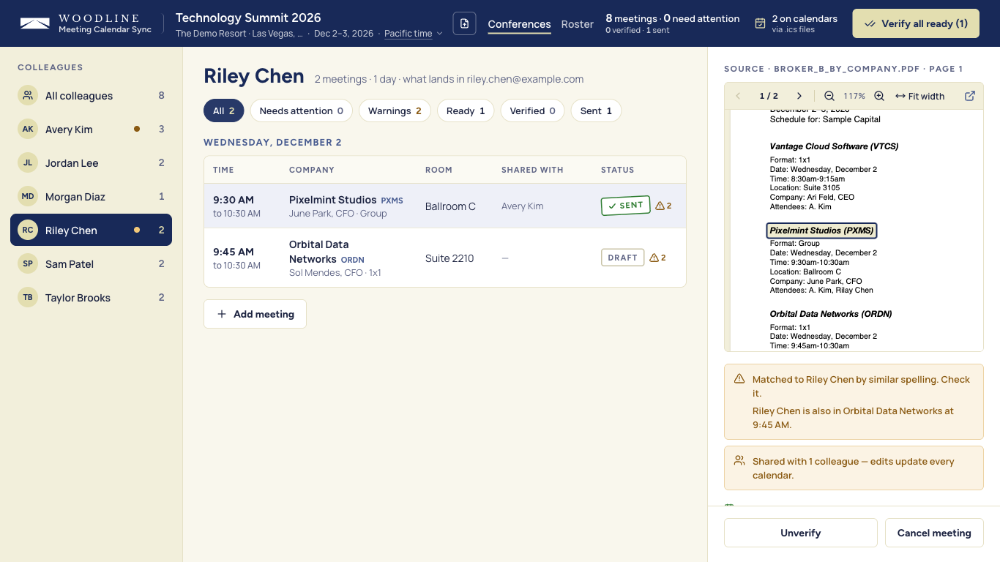

# Meeting Calendar Sync

A tool for turning a broker's conference schedule PDF into correct calendar entries. Upload a
schedule, Claude reads every meeting off the page, a human reviews and corrects what it found, and
verifying a meeting puts it on the right colleagues' calendars — automatically, and automatically
again if the broker sends a revised PDF.

> Unofficial prototype built by Nanzheng Xie for a calendar coordinator's workflow. Not an official
> Woodline Partners product; the Woodline look is used for an internal demo. All sample schedules,
> companies and people in `samples/` are fictional.

## How it works

1. **Upload** the broker's schedule PDF.
2. **Claude extracts** every meeting: date, time, room, company, ticker, format (1:1, group, meal)
   and who from the firm and the company attends.
3. **The coordinator ("CR") reviews** each meeting against the PDF, fixing anything Claude got
   wrong and resolving any flags (an unmatched name, a missing time, a double-booking).
4. **Verifying** a meeting sends it to calendars right away, in the same request — there's no
   separate "Send" step. Microsoft Graph writes directly into each colleague's calendar using CR's
   own delegate access; until IT approves Graph, CR downloads an `.ics` file per colleague instead
   and imports it into their calendar herself. Editing, deleting or re-verifying a meeting syncs
   calendars the same way.
5. **A revised broker PDF is recognised automatically** on upload (same conference name, or same
   hotel with overlapping dates). CR reviews only what changed — "Revision 2 — 5 changes," each
   with a before → after — accepts some or all of it, and calendars update to match.



## Quick start (local)

```bash
cd backend && uv sync
cd frontend && npm ci && npm run build
cd backend && uv run mcs seed-roster
uv run mcs serve
```

Then open **http://127.0.0.1:8765**.

`mcs seed-roster` loads the sample roster (`samples/roster.sample.json`) so there are colleagues to
match meetings against; `mcs serve` starts the app, serving the built frontend. Add
`--seed-sample-roster` to `mcs serve` to seed automatically on first start (used by the hosted
demo), or `--host` / `--port` to bind somewhere other than `127.0.0.1:8765`.

## Claude access

Extraction is provided by Claude, through one of these providers (`MCS_EXTRACTOR`):

| `MCS_EXTRACTOR` | Uses | Needs |
| --- | --- | --- |
| `auto` (default) | `anthropic` if a key is found, else `claude-code` | — |
| `anthropic` | Anthropic API | `ANTHROPIC_API_KEY` (env or Keychain) |
| `claude-code` | the local Claude Code CLI (`claude -p`), no API key | Claude Code installed and signed in |
| `foundry` | Microsoft Foundry | `ANTHROPIC_FOUNDRY_RESOURCE`, plus a Foundry key or Entra sign-in |
| `fake` | the committed sample PDFs only, no network | nothing — used by tests and offline demos |

Never put API keys in a file. Store the Anthropic key in the macOS Keychain instead:

```bash
security add-generic-password -a "$USER" -s meeting-calendar-sync.anthropic-api-key -w
```

(This prompts for the key interactively.) The app checks `ANTHROPIC_API_KEY` first, then that
Keychain service. `MCS_MODEL` overrides the model for any provider.

To switch to Microsoft Foundry instead: set `MCS_EXTRACTOR=foundry` and
`ANTHROPIC_FOUNDRY_RESOURCE`, then either store a key in the Keychain
(`meeting-calendar-sync.foundry-api-key`) / `ANTHROPIC_FOUNDRY_API_KEY`, or sign in with Entra ID
after installing the optional dependency: `uv sync --extra foundry-entra`.

## Calendars

- **`.ics` (default, `MCS_CALENDAR_SINK=ics`):** no setup needed. CR downloads one `.ics` file per
  colleague (or a zip of all of them) from the sync status line and imports it into Outlook.
- **Microsoft Graph (`MCS_CALENDAR_SINK=graph`):** writes straight into each colleague's calendar
  as CR, using her delegate access — colleagues never import anything themselves. Setup:
  1. In Entra, register an app and enable **"Allow public client flows."**
  2. Add the delegated permission **`Calendars.ReadWrite.Shared`** (admin consent may be required).
  3. Set `MCS_GRAPH_CLIENT_ID` and `MCS_GRAPH_TENANT_ID`, and `MCS_CALENDAR_SINK=graph`.

  **The Graph path is tested against a mock only — it has not been exercised against a real Microsoft
  365 tenant.** Treat it as unverified until someone has run it against a live tenant.

## Hosted demo (Cloudflare Containers)

A hosted copy can run the same container on Cloudflare, behind a Worker that requires a shared
password before anything else is served. It's meant for a quick look, not day-to-day use:
**the container's disk resets whenever it sleeps or is redeployed**, so anything uploaded there is
temporary. Don't upload real broker schedules to the hosted copy unless your firm's data rules
allow it — use it with the sample PDFs in `samples/`.

```bash
cd deploy/cloudflare && npm ci
npx wrangler login
npx wrangler deploy
npx wrangler secret put APP_PASSWORD
security find-generic-password -s meeting-calendar-sync.anthropic-api-key -w | tr -d '\n' | npx wrangler secret put ANTHROPIC_API_KEY
```

## Development

```bash
cd backend && uv run pytest                        # backend tests
cd frontend && npx vitest run                       # frontend tests
cd backend && uv run python scripts/eval_extraction.py     # score the configured extractor against samples/
cd backend && uv run python scripts/make_sample_pdfs.py    # regenerate the synthetic sample PDFs
```

Folder layout:

```
backend/
  mcs/            # FastAPI app, extraction, roster matching, calendar sinks, cli.py
  scripts/        # eval_extraction.py, make_sample_pdfs.py
  tests/
frontend/         # Vite + React + TypeScript
samples/          # synthetic broker PDFs, expected JSON, sample roster (committed)
data/             # local runtime DB and uploads (git-ignored)
private/samples/  # real broker PDFs for local extraction testing only (git-ignored)
```

Design spec: [`docs/superpowers/specs/2026-10-16-meeting-calendar-sync-design.md`](docs/superpowers/specs/2026-10-16-meeting-calendar-sync-design.md).
Implementation plan: [`docs/superpowers/plans/2026-10-16-meeting-calendar-sync.md`](docs/superpowers/plans/2026-10-16-meeting-calendar-sync.md).

## Limitations

- **Single user.** This is built for one coordinator working through one conference at a time, not
  a multi-user or multi-tenant tool.
- **Hosted data is ephemeral.** The Cloudflare demo's data resets when the container sleeps or is
  redeployed — don't rely on it to keep anything.
- **Graph is untested against a real tenant.** The Microsoft Graph calendar sink has only been
  exercised against a mock; `.ics` export is the proven path today.
